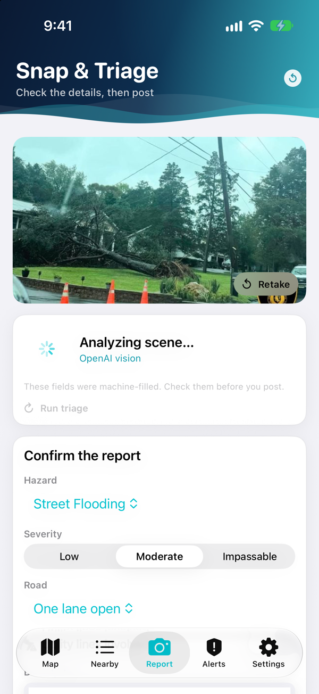
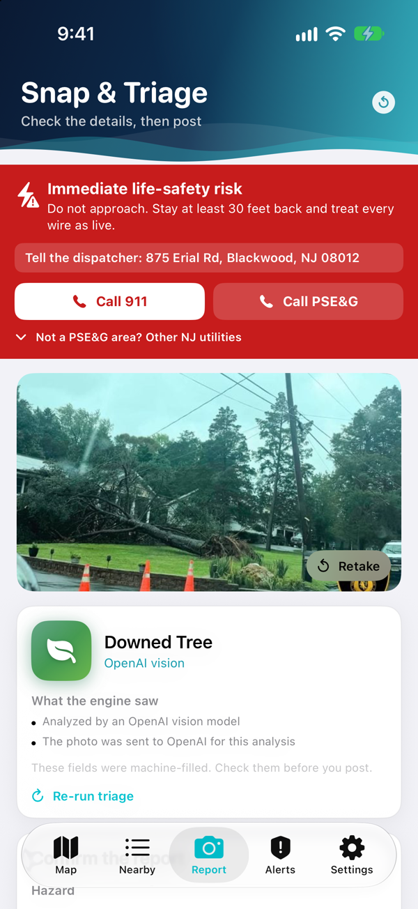
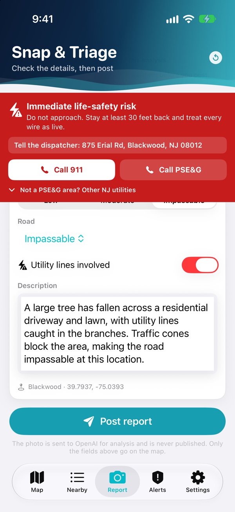
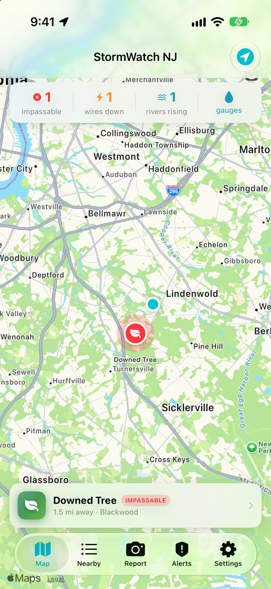
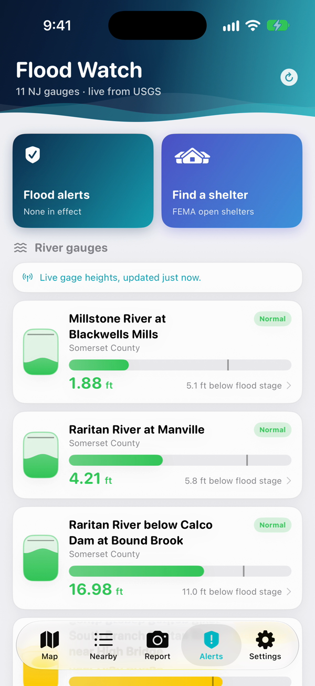
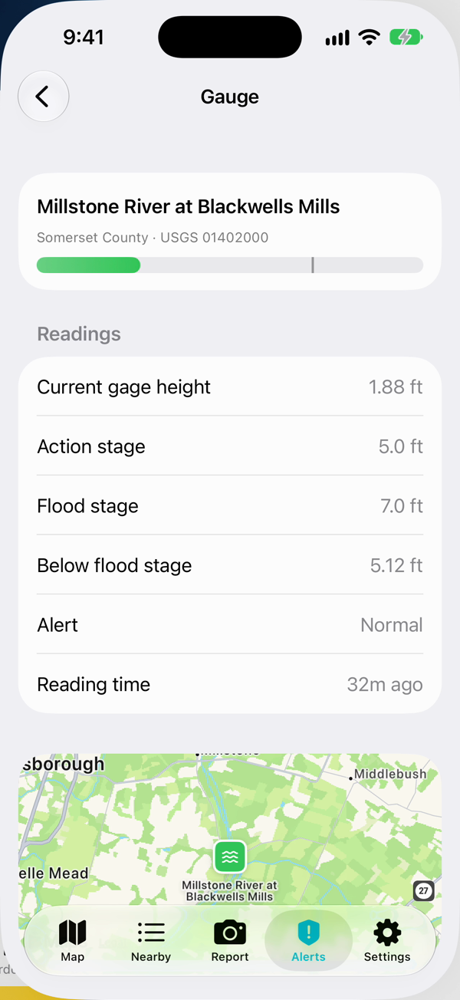
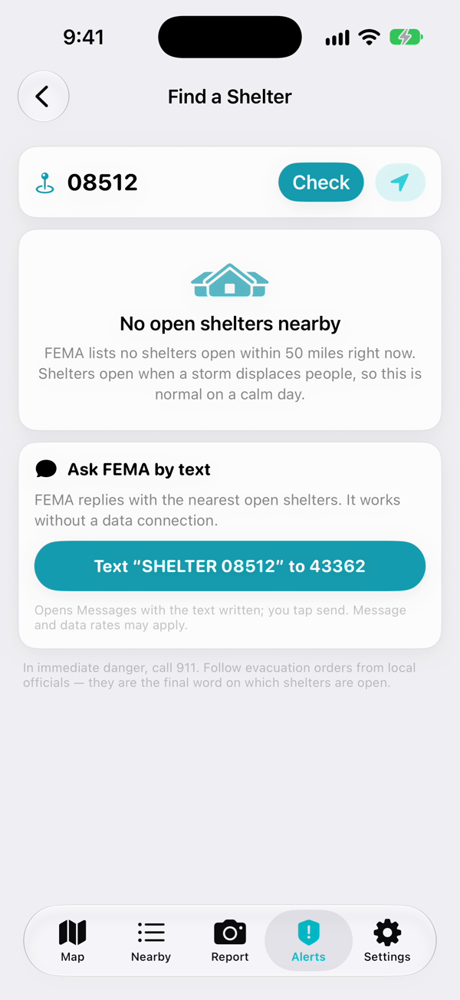

# StormWatch NJ

**A neighbor-powered storm hazard map for New Jersey.** Snap a photo of a flooded
road, a fallen tree, a clogged storm drain or a downed power line. AI fills in the
report, you check it, and it goes on a live map for everyone nearby and to your
town's public works department.

Built for the Congressional App Challenge, as an iPhone app and a matching website
that share one backend.

<p align="center">
  
  
  
  
</p>

## How it works

1. **Snap.** Take a photo, or choose one from your library.
2. **AI creates the report.** An OpenAI vision model reads the photo and fills in
   the hazard type, how severe it is, whether the road is passable, whether power
   lines are involved, and a short description for a public works crew.
3. **You approve.** AI can make mistakes, so every field stays editable and nothing
   is posted until you tap **Post report**.
4. **Live map.** The hazard appears on the map for everyone nearby, is filed with
   the town's public works desk, and can be shared to Nextdoor in one tap.

### When wires are involved

If the photo shows downed wires, or you switch on **Utility lines involved**, a red
safety banner appears: stay at least 30 feet back, treat every wire as live, and
call **911** or **PSE&G** with one tap. JCP&L, Atlantic City Electric and Orange &
Rockland are one tap further. The banner shows the street address to read to the
dispatcher.

## Staying safe in a storm

<p align="center">
  
  
  
</p>

- **River levels.** Live water heights from 11 USGS gauges on the Raritan,
  Millstone, Passaic and other New Jersey rivers, each compared with its flood
  stage. Rivers near flood stage are flagged on the map.
- **Flood alerts.** Warnings in effect now from the National Weather Service, plus
  the past 90 days from FEMA's alert archive, for your location or any NJ ZIP code.
- **Shelters.** Open emergency shelters from FEMA within 50 miles, with directions,
  or one tap to text `SHELTER <zip>` to FEMA at 43362, which works with no data
  connection.

## Keeping the map accurate

A hazard comes off the map when:

- **Three neighbors** within 1 mile of it each tap **It's not there anymore**,
- **the person who reported it** removes it,
- **a township** clears it, or
- **3 days** pass with no update.

Each account gets one vote, and you can't vote on your own report. Two reports of
the same hazard close together become one report with two confirmations.

## For towns

Township staff sign in with their official email. Only addresses on 19 recognised
municipal domains, confirmed by email, get a township account. In place of the
Nearby tab they get the **DPW console**:

- every open hazard, sorted the way a crew would work it
- crew status (**DPW en route**, **Resolved**) and removal
- GeoJSON and CSV export
- a live GeoJSON feed to add to ArcGIS or QGIS

Every report is filed over [Open311](https://wiki.open311.org/GeoReport_v2/), the
civic standard many 311 systems already use, and towns that opt in receive it at
their public works desk.

## More features

- **Nearby list:** every hazard in your search radius, nearest first, filtered by type.
- **Notifications:**
  - a flood alert where you are
  - an impassable road or downed wire nearby
  - updates on your own reports
- **Nextdoor:** after posting, Nextdoor's composer opens with the post written for
  you. You review it and post it there.
- **Sign in:** with email, or with Google.
- **Demo mode:** **Simulate nor'easter** adds clearly labelled sample hazards and
  pushes every river past flood stage, so the app can be shown on a sunny day.

## The AI

Every photo is sent to the `analyze-image` server function, which asks OpenAI's
`gpt-4.1-mini` vision model for a structured answer that can only contain:

- one of five hazard types
- one of three severities
- one of three road statuses
- whether power lines are involved
- a 1–2 sentence description

The OpenAI key is kept encrypted on the server and is never in the app or this
repository. The photo is used for that one request and is not stored or published.

## Where the data comes from

| Source | Used for |
| --- | --- |
| [USGS Water Services](https://waterservices.usgs.gov/) | Live river gauge heights |
| [National Weather Service](https://www.weather.gov/documentation/services-web-api) | Flood alerts in effect now |
| [FEMA OpenFEMA](https://www.fema.gov/about/openfema/data-sets) | Past flood alerts |
| [FEMA Open Shelters](https://gis.fema.gov/) | Open emergency shelters |
| [OpenAI](https://platform.openai.com/) | Photo analysis |
| Apple Maps / OpenStreetMap | Maps and street addresses |

The flood stages in this build are demo values. Replace them with official NWS
flood stages before real use.

## Built with

| Part | Technology |
| --- | --- |
| iPhone app | Swift, SwiftUI, MapKit, CoreLocation |
| Website | TypeScript, React, Vite, Leaflet |
| Backend | [Supabase](https://supabase.com): PostgreSQL + PostGIS, Auth, Edge Functions (TypeScript), Vault |
| Rules | SQL: who can vote or remove, the 1-mile and 3-vote rules, expiry, township roles |
| Tools | Python |

## Run it

**iPhone app.** Open `StormWatchNJ.xcodeproj` in Xcode 15 or newer, pick an iPhone
simulator and press **⌘R**. Nothing else to install; the backend is already
hosted. To put the simulator in New Jersey:

```bash
xcrun simctl location booted set 40.3318,-74.5893
```

**Website.**

```bash
cd web
npm install
npm run dev
```

Setup for email sign-in, Google sign-in, town forwarding and deployment is in
[docs/SETUP.md](docs/SETUP.md). The website's details are in
[web/README.md](web/README.md).

## Project layout

```
StormWatchNJ/      the iPhone app (Models, Services, Views)
web/               the website
supabase/          database migrations, server functions and tests
docs/              setup notes and screenshots
Tools/             project file and app icon generators
```

## Privacy

- Photos are sent to OpenAI only to fill in the report. They are never stored or
  published.
- Your location is attached to a report only when you post one.
- Who filed a report is never shown to anyone else.

In an emergency, call 911.
